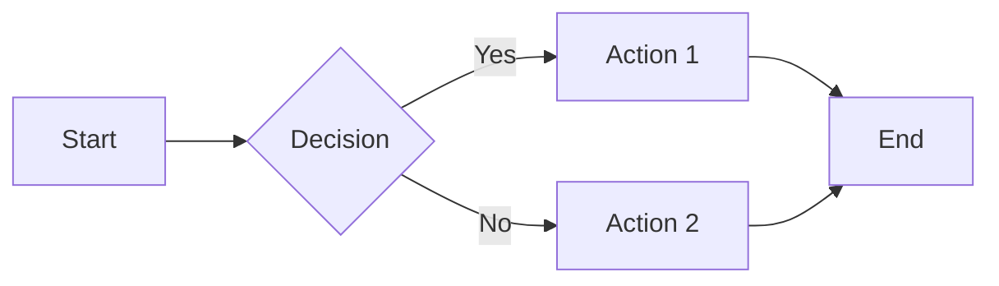

# Carbon Markup Language (`.cb`) — Documentação Oficial

O **Carbon** é uma linguagem de marcação moderna e minimalista desenvolvida para simplificar a criação de documentos acadêmicos e científicos, compilando marcações limpas diretamente para PDFs de qualidade tipo LaTeX.

## Sumário
1. [Inicialização do Documento](#1-inicialização-do-documento)
2. [Sumário Automático (Table of Contents)](#2-sumário-automático-table-of-contents)
3. [Estrutura de Seções e Texto](#3-estrutura-de-seções-e-texto)
4. [Listas e Enumerações](#4-listas-e-enumerações)
5. [Imagens, Tabelas e Mídia](#5-imagens-tabelas-e-mídia)
6. [Diagramas Mermaid](#6-diagramas-mermaid)
7. [Referências e Citações Bibliográficas](#7-referências-e-citações-bibliográficas)
8. [Expressões Matemáticas e Símbolos](#8-expressões-matemáticas-e-símbolos)
9. [Layout, Posicionamento e Quebras de Página](#9-layout-posicionamento-e-quebras-de-página)
10. [Alinhamento e Formatação de Texto](#10-alinhamento-e-formatação-de-texto)

---

## 1. Inicialização do Documento

Defina os metadados principais do trabalho no início do arquivo:

```carbon
@title Este é o Título do seu Documento

# Escolha a estrutura do documento:
@type article   # Título e metadados integrados na primeira página
# OU
@type report    # Gera uma capa dedicada para o título e metadados

# Declaração de Autor(es)
@author Barcelos-Pusch, D.
@author Santana, L. F.

# Declaração com Filiação/Instituição (Opcional)
@author [Barcelos-Pusch, D.]{Nome da Instituição A}
@author [Santana, L. F.]{Nome da Instituição B}

# Data do Documento
@date November $5^{\text{th}}$, 2026
# OU data automática da compilação:
@date @today
```

---

## 2. Sumário Automático (Table of Contents)

Para gerar automaticamente um sumário baseado nos cabeçalhos (`#`, `##`, `###`) do documento, insira a diretiva `@toc` ou `@tableofcontents`:

```carbon
# Sumário padrão com título automático
@toc

# Sumário com personalização do título exibido
@toc[title="Índice Geral"]
@toc[title="Conteúdo"]
@toc[title="Table of Contents"]
```

---

## 3. Estrutura de Seções e Texto

### Cabeçalhos
```carbon
# Título Nível 1 (Capítulo / Seção Principal)
## Título Nível 2 (Subseção)
### Título Nível 3 (Sub-subseção)
```

### Formatação Visual
```markdown
*itálico* ou _itálico_
**negrito** ou __negrito__
~~riscado~~
[Texto do link](https://url-do-site.com)
```

### Citações e Referências Cruzadas Internas
```carbon
... conforme visto na Figura @ref(fig:figura) ...
... dados apresentados na Tabela @ref(table:tabela) ...

# Referência automática (inclui o prefixo "Figura", "Tabela", etc.)
... @autoref(fig:figura) ...

# Referência à página
... veja na página @pageref(table:tabela) ...
```

---

## 4. Listas e Enumerações

O Carbon suporta listas não ordenadas e diversos formatos de ordenação e numeração de forma automática:

### Listas Não Ordenadas (Marcadores)
```markdown
- Item de lista com hífen
* Item de lista com asterisco
  - Subitem aninhado (use recuo/indentação)
```

### Listas Numeradas (Ordenadas)
```markdown
1. Primeiro item
2. Segundo item
   1. Subitem numerado
```

### Listas Alfabéticas e Romanas
```markdown
a. Primeira opção minúscula
b. Segunda opção minúscula

A. Primeira opção maiúscula
B. Segunda opção maiúscula

a) Opção com parêntese simples
b) Outra opção

A) Opção maiúscula com parêntese
B) Outra opção

i. Item em numeração romana minúscula (i, ii, iii...)
I. Item em numeração romana maiúscula (I, II, III...)
```

---

## 5. Imagens, Tabelas e Mídia

### Tabelas
Tabelas simples usam sintaxe em Markdown:

```markdown
| Parameter | Value |
| --- | --- |
| Date and Time | 2026-05-07 04:11:17.300 |
| RA | 11 04 47.2817454 $\pm$ 1.797 mas |
| DEC | 3 10 30.848615 $\pm$ 1.421 mas |
```

Para adicionar legenda, chave de referência e dimensionamento:

```carbon
@caption Descrição detalhada da tabela. {#table:tabela width=100%}
| Parameter | Value |
| --- | --- |
| Date and Time | 2026-05-07 04:11:17.300 |
| RA | 11 04 47.2817454 $\pm$ 1.797 mas |
```

### Imagens e Páginas de PDF
```carbon
# Imagens PNG, JPEG ou JPG
{#fig:figura width=75%}

# Importação de página específica de PDF
{#fig:pagina-pdf width=75% page=2}
```
*   `![Legenda]`: Texto descritivo da imagem (opcional).
*   `(caminho)`: Caminho relativo do arquivo no projeto.
*   `{#id width=75%}`: Identificador para citação cruzada e porcentagem de largura.

---

## 6. Diagramas Mermaid

### Diagrama Inline (Bloco Direto)
````markdown

````

### Diagrama via Arquivo Externo Centralizado (`.mmd`)

1. Importe o arquivo contendo a biblioteca de esquemas no topo do documento:
```carbon
@import caminho/para/diagramas.mmd
```

2. No local desejado, insira a chamada pela chave do diagrama:
```carbon
@mermaid #fig:sequencia width=80%
```

3. Estrutura do arquivo de diagramas (`diagramas.mmd`):
```carbon
#fig:sequencia{
graph LR;
  A[Start] --> B{Decision};
  B -->|Yes| C[Action 1];
  B -->|No| D[Action 2];
  C --> E[End];
  D --> E;
}
```

---

## 7. Referências e Citações Bibliográficas

O Carbon possui um sistema nativo para gerenciamento de citações sem a verborragia tradicional do BibTeX.

### 1. Importando o Arquivo de Referências
```carbon
@import assets/referencias.cb
```

### 2. Estrutura das Entradas (`referencias.cb`)
```carbon
@entry #barcelos2026 {
  type: article,
  author: "Barcelos, Dimitri; Silva, Dahiane",
  title: "Caça a Asteroides via Análise Computacional",
  journal: "Revista de Ciência Escolar",
  year: 2026
}

@entry #sara_npca {
  type: software,
  author: "Barcelos, Dimitri",
  title: "SARA-NPCA: Sistema de Registro de Asteroides",
  url: "https://e-npca.vercel.app",
  year: 2026
}
```

### 3. Citação no Texto
```carbon
Segundo a metodologia apresentada em @cite(barcelos2026), a análise de imagens permite a detecção precisa de candidatos.
O processamento é realizado pela plataforma @cite(sara_npca).
```

### 4. Compilação da Bibliografia
Insira a diretiva no local desejado para gerar a lista de obras citadas:
```carbon
# Referências
@print_bibliography[style=abnt]
```

#### Estilos Suportados (`style`)
*   `abnt`: Norma NBR 6023 (Padrão acadêmico brasileiro)
*   `ieee`: Citações numéricas em colchetes `[1]` (Engenharias e Tecnologia)
*   `apa`: Sistema Autor-Ano 7ª ed. (Ciências Sociais e Exatas)
*   `mla`: Modern Language Association 9ª ed. (Humanas e Literatura)
*   `vancouver`: Sequencial por ordem de citação (Áreas médicas)
*   `chicago`: Chicago Manual of Style Autor-Data

---

## 8. Expressões Matemáticas e Símbolos

O Carbon suporta renderização completa em LaTeX Math tanto inline quanto em bloco.

### Expressões Inline e Bloco
*   **Inline:** `$E = mc^2$` ou `$x_i$`
*   **Bloco Simples:**
    ```latex
    $$
    f(x) = \frac{\alpha x^2 + \beta}{\sqrt{1 + x^2}}
    $$
    ```
*   **Bloco de Alinhamento:**
    ```latex
    $$
    \begin{aligned}
    \nabla\cdot\mathbf{E} &= \frac{\rho}{\varepsilon_0} \\
    \nabla\cdot\mathbf{B} &= 0 \\
    \nabla\times\mathbf{E} &= -\frac{\partial\mathbf{B}}{\partial t}
    \end{aligned}
    $$
    ```

### Letras Gregas

| Tipo | Comandos |
| :--- | :--- |
| **Minúsculas** | `\alpha`, `\beta`, `\gamma`, `\delta`, `\epsilon`, `\varepsilon`, `\zeta`, `\eta`, `\theta`, `\vartheta`, `\iota`, `\kappa`, `\lambda`, `\mu`, `\nu`, `\xi`, `\pi`, `\rho`, `\varrho`, `\sigma`, `\varsigma`, `\tau`, `\upsilon`, `\phi`, `\varphi`, `\chi`, `\psi`, `\omega` |
| **Maiúsculas** | `\Gamma`, `\Delta`, `\Theta`, `\Lambda`, `\Xi`, `\Pi`, `\Sigma`, `\Upsilon`, `\Phi`, `\Psi`, `\Omega` |

### Setas Matemáticas

| Símbolo | Comando | Símbolo | Comando |
| :--- | :--- | :--- | :--- |
| $\leftarrow$ | `\leftarrow` | $\Leftarrow$ | `\Leftarrow` |
| $\rightarrow$ | `\rightarrow` | $\Rightarrow$ | `\Rightarrow` |
| $\leftrightarrow$ | `\leftrightarrow` | $\Leftrightarrow$ | `\Leftrightarrow` |
| $\uparrow$ | `\uparrow` | $\Uparrow$ | `\Uparrow` |
| $\downarrow$ | `\downarrow` | $\Downarrow$ | `\Downarrow` |
| $\mapsto$ | `\mapsto` | $\longmapsto$ | `\longmapsto` |
| $\nearrow$ | `\nearrow` | $\searrow$ | `\searrow` |
| $\swarrow$ | `\swarrow` | $\nwarrow$ | `\nwarrow` |

### Símbolos Diversos e Miscelânea

| Símbolo | Comando | Símbolo | Comando |
| :--- | :--- | :--- | :--- |
| $\infty$ | `\infty` | $\forall$ | `\forall` |
| $\exists$ | `\exists` | $\nexists$ | `\nexists` |
| $\nabla$ | `\nabla` | $\partial$ | `\partial` |
| $\emptyset$ | `\emptyset` | $\varnothing$ | `\varnothing` |
| $\Re$ | `\Re` | $\Im$ | `\Im` |
| $\wp$ | `\wp` | $\neg$ | `\neg` |
| $\surd$ | `\surd` | $\triangle$ | `\triangle` |
| $\square$ | `\square` | $\blacksquare$ | `\blacksquare` |

### Operadores e Relações Binárias

| Símbolo | Comando | Símbolo | Comando |
| :--- | :--- | :--- | :--- |
| $\times$ | `\times` | $\cdot$ | `\cdot` |
| $\div$ | `\div` | $\cap$ | `\cap` |
| $\cup$ | `\cup` | $\neq$ | `\neq` |
| $\leq$ | `\leq` | $\geq$ | `\geq` |
| $\in$ | `\in` | $\notin$ | `\notin` |
| $\subset$ | `\subset` | $\perp$ | `\perp` |
| $\approx$ | `\approx` | $\simeq$ | `\simeq` |
| $\equiv$ | `\equiv` | $\cong$ | `\cong` |
| $\wedge$ | `\wedge` | $\vee$ | `\vee` |
| $\oplus$ | `\oplus` | $\otimes$ | `\otimes` |

---

## 9. Layout, Posicionamento e Quebras de Página

### Posicionamento de figuras, tabelas e diagramas

Use `pos=[...]` dentro dos atributos da figura ou da legenda da tabela. O mesmo atributo funciona em blocos Mermaid e em chamadas `@mermaid`.

| Modificador | Alias | Comportamento |
| --- | --- | --- |
| `here` | `h` | Posição fixa na sequência do conteúdo, com `[H]` do pacote LaTeX float. |
| `top` | `t` | Permite posicionamento no topo de uma página. |
| `bottom` | `b` | Permite posicionamento na parte inferior de uma página. |
| `page` | `p` | Permite uma página dedicada a elementos flutuantes. |
| `override` | `!` | Flexibiliza as restrições de flutuação do LaTeX. Não garante posição imediata. |

`here` tem prioridade quando combinado com outras posições: `pos=[here, top]` resulta em `[H]`. Um elemento fixo que não caiba no espaço restante passa para a página seguinte. As posições top, bottom e page são opções para a paginação, não garantias de uma página específica. Use `pos=[page]` para permitir somente páginas de elementos flutuantes; isso não cria uma página por elemento.

`pos=[override, top]` corresponde a `[!t]`. `pos=[override]` corresponde a `[!htbp]`. Sem `pos`, mantém-se `[htbp]`. Os modificadores podem ser combinados com vírgulas; valores desconhecidos geram erro.

```carbon
{#fig:sis width=80% pos=[here, top]}

@caption Resultados obtidos. {#table:res width=100% pos=[top]}
| Parâmetro | Medição |
| --- | --- |
| Fluxo | 99.4% |

@mermaid #fig:sequencia width=80% pos=[page]
```

### Quebra manual de página

`@newpage` em uma linha própria gera `\newpage` no LaTeX. O conteúdo seguinte começa em uma nova página. Assim como no LaTeX, esse comando não esvazia a fila de figuras e tabelas flutuantes.

```carbon
# Seção anterior
O texto anterior termina aqui.

@newpage

# Nova página
Este conteúdo começa na página seguinte.
```

### Margens, papel e tipografia

Declare os blocos no cabeçalho do documento. Cada bloco é opcional; propriedades omitidas mantêm os valores padrão. Use no máximo um bloco de cada tipo por documento, incluindo importações. Os blocos aceitam campos em linhas separadas ou separados por vírgulas e comentários iniciados por `#` fora de strings.

```carbon
@title Relatório Técnico Avançado
@type report

@margins {
  top: 2.5cm,
  bottom: 2.5cm,
  left: 3.0cm,
  right: 2.0cm
}

@page {
  size: A4,              # A4, Letter, Legal ou A5
  orientation: portrait  # portrait ou landscape
}

@typography {
  font: "Liberation Sans",
  fontsize: 12pt,
  lineheight: 1.5
}
```

- **Margens:** medidas não negativas em `cm`, `mm` ou `in`. O conjunto deve deixar uma área útil positiva na página.
- **Papel:** A4, Letter, Legal ou A5. A orientação pode ser `portrait` (retrato) ou `landscape` (paisagem).
- **Fonte:** nome da família entre aspas. Latin Modern Roman, TeX Gyre Heros, TeX Gyre Termes e TeX Gyre Pagella usam fontes do conjunto TeX. Outras famílias, incluindo Liberation Sans, precisam estar instaladas no Windows. Uma fonte ausente gera erro explícito; não há substituição silenciosa.
- **Tamanho:** medida em `pt`, entre 1pt e 200pt, incluindo tamanhos como 14pt. O tamanho vale para o texto normal; títulos mantêm a hierarquia tipográfica do LaTeX.
- **Entrelinha:** fator numérico maior que zero e até 10; por exemplo `1`, `1.5` ou `2`. Multiplica a distância entre linhas definida pela fonte. Notas de rodapé, legendas e tabelas seguem os ajustes próprios do pacote setspace.

Sem configuração, o documento usa margens de 1in, orientação retrato, Latin Modern 12pt e entrelinha 1. O papel vem das preferências do Studio (A4 inicialmente); `@page size` no arquivo tem prioridade. A fonte de texto personalizada não troca a família das equações matemáticas.

### Controles do Studio

- **Layout do documento:** edita papel, orientação, margens, fonte, tamanho e entrelinha e grava os três blocos no próprio código. A alteração pode ser desfeita com Ctrl+Z e precisa ser salva com Ctrl+S.
- **Quebra de página:** insere `@newpage` no cursor.
- **Posicionar figura / tabela:** com o cursor na linha de uma figura, `@caption`, `@mermaid` ou abertura de um bloco Mermaid, adiciona ou atualiza `pos=[...]`.
- O editor realça os novos blocos e oferece sugestões ao digitar `@`. Recompile com Ctrl+Enter para atualizar o PDF.

Exemplo autocontido: `studio-app/examples/layout.cb`.


---

## 10. Alinhamento e Formatação de Texto

### Blocos de texto

Use `@align(alinhamento)[` e feche o bloco com `]` em uma linha própria. O texto mantém negrito, itálico, links, referências e matemática inline. Linhas em branco separam parágrafos; uma simples mudança de linha continua o mesmo parágrafo.

| Alinhamento | Aliases | Resultado |
| --- | --- | --- |
| `left` | `l`, `L` | Texto alinhado à esquerda, com margem direita irregular. |
| `center` | `c`, `C` | Texto centralizado. |
| `right` | `r`, `R` | Texto alinhado à direita, com margem esquerda irregular. |
| `justify` | `j`, `J` | Texto justificado entre as margens. |

```carbon
@align(left)[
Este parágrafo fica alinhado à esquerda.
]

@align(center)[
Texto centralizado com **destaque** e matemática $E=mc^2$.
]

@align(R)[
Este parágrafo fica alinhado à direita.
]

@align(justify)[
Este bloco distribui o texto entre as duas margens. O LaTeX continua responsável pela composição e pela hifenização dos parágrafos.
]
```

Os blocos podem ser aninhados, até 16 níveis; o fechamento restaura o alinhamento anterior. Fora de blocos, os parágrafos mantêm o padrão justificado do LaTeX. Figuras e tabelas continuam usando suas próprias regras de composição e posicionamento.

Também é possível escrever um parágrafo curto em uma única linha:

```carbon
@align(center)[Um parágrafo centralizado.]
```

### Colunas de tabelas

Defina o alinhamento na linha divisória, imediatamente após o cabeçalho. Ele vale para o cabeçalho e para as células da coluna.

| Sintaxe | Alinhamento |
| --- | --- |
| `---` ou `:---` | Esquerda (padrão das tabelas). |
| `:---:` | Centro. |
| `---:` | Direita. |
| `:---=` | Justificado. |

```carbon
@caption Tabela com alinhamentos distintos. {#table:alinhamento width=100% pos=[here]}
| Esquerda | Centralizado | Direita | Justificado |
| :--- | :---: | ---: | :---= |
| Item A | 100 | R$ 15,00 | Uma descrição longa será distribuída entre as margens da célula. |
| Item B | 250 | R$ 120,50 | Outra descrição mantém a justificação definida para a coluna. |
```

A linha divisória não aparece no PDF. As colunas mantêm larguras iguais e o texto pode ocupar várias linhas dentro da célula. Tabelas sem especificadores de alinhamento usam esquerda por padrão, desde a versão 0.1.4.

### Uma célula individual

Envolva todo o conteúdo da célula com `@align(alinhamento)[conteúdo]`. Esse alinhamento tem prioridade sobre a coluna, preservando a largura da célula e o alinhamento das células seguintes.

```carbon
| Parâmetro | Valor | Observação |
| :--- | :---: | :--- |
| Status | @align(center)[**OK**] | @align(right)[Concluído] |
| Outro | 250 | Mantém o alinhamento da coluna. |
```

Cada célula aceita um único envoltório `@align`. Links e matemática inline podem aparecer dentro dele. Um caractere de barra vertical literal fora de matemática pode ser escrito como `\|`; barras dentro de expressões `$...$` são preservadas sem dividir a célula.

### No Studio

Use **Alinhamento de texto** no painel lateral:

- **Bloco de texto selecionado:** envolve a seleção por `@align`; sem seleção, usa a linha atual.
- **Coluna da tabela no cursor:** atualiza apenas o especificador da coluna. Se necessário, insere a linha divisória após o cabeçalho.
- **Somente a célula no cursor:** envolve o conteúdo da célula ou troca o alinhamento de um envoltório existente.

As alterações são feitas no código, podem ser desfeitas/refeitas e precisam ser salvas e recompiladas. O editor realça `@align` e oferece sugestões ao digitar `@`, com sintaxe inline para células.

Exemplo autocontido: `studio-app/examples/alinhamento.cb`.
