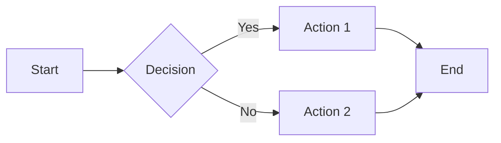
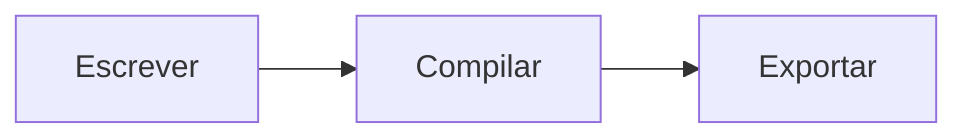

<!-- Gerado de LANGUAGE.md por npm run docs:sync. Edite a referência na raiz. -->

# Carbon Markup Language (`.cb`)

Referência da linguagem Carbon do Carbon Studio 0.4.0. A fonte `.cb` é transformada em LaTeX e composta em PDF pelo Tectonic. O guia integrado do aplicativo usa este mesmo documento.

## Navegação

- [1. Inicialização do Documento](#1-inicialização-do-documento)
- [2. Sumário Automático (Table of Contents)](#2-sumário-automático-table-of-contents)
- [3. Estrutura de Seções e Texto](#3-estrutura-de-seções-e-texto)
- [4. Listas e Enumerações](#4-listas-e-enumerações)
- [5. Imagens, Tabelas e Mídia](#5-imagens-tabelas-e-mídia)
- [6. Diagramas Mermaid](#6-diagramas-mermaid)
- [7. Referências e Citações Bibliográficas](#7-referências-e-citações-bibliográficas)
- [8. Expressões Matemáticas e Símbolos](#8-expressões-matemáticas-e-símbolos)
- [9. Layout, Posicionamento e Quebras de Página](#9-layout-posicionamento-e-quebras-de-página)
- [10. Alinhamento e Formatação de Texto](#10-alinhamento-e-formatação-de-texto)
- [11. Comentários e parágrafos](#11-comentários-e-parágrafos)
- [12. Equações simplificadas](#12-equações-simplificadas)
- [13. Colunas](#13-colunas)
- [14. Legendas, fontes e subfiguras](#14-legendas-fontes-e-subfiguras)
- [15. Estilos de links](#15-estilos-de-links)
- [16. Blocos científicos e reutilização](#16-blocos-científicos-e-reutilização)
- [17. Projetos modulares e diagnósticos](#17-projetos-modulares-e-diagnósticos)
- [18. Studio e tipos de arquivo](#18-studio-e-tipos-de-arquivo)
- [19. Currículos](#19-currículos)

## 1. Inicialização do Documento

Defina os metadados principais do trabalho no início do arquivo:

```carbon
@title Este é o Título do seu Documento

// Escolha a estrutura do documento:
@type article   # Título e metadados integrados na primeira página
// OU
@type report    # Gera uma capa dedicada para o título e metadados

// Declaração de Autor(es)
@author Barcelos-Pusch, D.
@author Santana, L. F.

// Declaração com Filiação/Instituição (Opcional)
@author [Barcelos-Pusch, D.]{Nome da Instituição A}
@author [Santana, L. F.]{Nome da Instituição B}

// Data do Documento
@date November $5^{\text{th}}$, 2026
// OU data automática da compilação:
@date @today
```

---

## 2. Sumário Automático (Table of Contents)

Para gerar automaticamente um sumário baseado nos cabeçalhos (`#`, `##`, `###`) do documento, insira a diretiva `@toc` ou `@tableofcontents`:

```carbon
// Sumário padrão com título automático
@toc

// Sumário com personalização do título exibido
@toc[title="Índice Geral"]
@toc[title="Conteúdo"]
@toc[title="Table of Contents"]
```

---

## 3. Estrutura de Seções e Texto

### Cabeçalhos
```carbon
# Título Nível 1 (Capítulo / Seção Principal)
## Título Nível 2 (Subseção)
### Título Nível 3 (Sub-subseção)
```

### Formatação Visual
```markdown
*itálico* ou _itálico_
**negrito** ou __negrito__
~~riscado~~
[Texto do link](https://url-do-site.com)
```

### Citações e Referências Cruzadas Internas
```carbon
... conforme visto na Figura @ref(fig:figura) ...
... dados apresentados na Tabela @ref(table:tabela) ...

// Referência automática (inclui o prefixo "Figura", "Tabela", etc.)
... @autoref(fig:figura) ...

// Referência à página
... veja na página @pageref(table:tabela) ...
```

---

## 4. Listas e Enumerações

O Carbon suporta listas não ordenadas e diversos formatos de ordenação e numeração de forma automática:

### Listas Não Ordenadas (Marcadores)
```markdown
- Item de lista com hífen
* Item de lista com asterisco
  - Subitem aninhado (use recuo/indentação)
```

### Listas Numeradas (Ordenadas)
```markdown
1. Primeiro item
2. Segundo item
   1. Subitem numerado
```

### Listas Alfabéticas e Romanas
```markdown
a. Primeira opção minúscula
b. Segunda opção minúscula

A. Primeira opção maiúscula
B. Segunda opção maiúscula

a) Opção com parêntese simples
b) Outra opção

A) Opção maiúscula com parêntese
B) Outra opção

i. Item em numeração romana minúscula (i, ii, iii...)
I. Item em numeração romana maiúscula (I, II, III...)
```

---


### Listas de tarefas

Use - [ ] para tarefas em aberto e - [X] para concluídas. Os marcadores são renderizados como caixas no PDF.

---

## 5. Imagens, Tabelas e Mídia

### Tabelas
Tabelas simples usam sintaxe em Markdown:

```markdown
| Parameter | Value |
| --- | --- |
| Date and Time | 2026-05-07 04:11:17.300 |
| RA | 11 04 47.2817454 $\pm$ 1.797 mas |
| DEC | 3 10 30.848615 $\pm$ 1.421 mas |
```

Para adicionar legenda, chave de referência e dimensionamento:

```carbon
@caption Descrição detalhada da tabela. {#table:tabela width=100%}
| Parameter | Value |
| --- | --- |
| Date and Time | 2026-05-07 04:11:17.300 |
| RA | 11 04 47.2817454 $\pm$ 1.797 mas |
```

### Imagens e Páginas de PDF
```carbon
// Imagens PNG, JPEG ou JPG
{#fig:figura width=75%}

# Importação de página específica de PDF
{#fig:pagina-pdf width=75% page=2}
```
*   `![Legenda]`: Texto descritivo da imagem (opcional).
*   `(caminho)`: Caminho relativo do arquivo no projeto.
*   `{#id width=75%}`: Identificador para citação cruzada e porcentagem de largura.

---

## 6. Diagramas Mermaid

### Diagrama Inline (Bloco Direto)
````markdown

````

### Diagrama via Arquivo Externo Centralizado (`.mmd`)

1. Importe o arquivo contendo a biblioteca de esquemas no topo do documento:
```carbon
@import caminho/para/diagramas.mmd
```

2. No local desejado, insira a chamada pela chave do diagrama:
```carbon
@mermaid #fig:sequencia width=80%
```

3. Estrutura do arquivo de diagramas (`diagramas.mmd`):
```carbon
#fig:sequencia{
graph LR;
  A[Start] --> B{Decision};
  B -->|Yes| C[Action 1];
  B -->|No| D[Action 2];
  C --> E[End];
  D --> E;
}
```

---


### Renderização integrada ao Studio

Insira o bloco abaixo e compile pelo Studio.

````carbon

````

As bibliotecas `.mmd` importadas com `@import` e as chamadas `@mermaid #fig:id` continuam disponíveis. O Studio desenha os diagramas em uma janela isolada do Chromium que já acompanha o Electron. O diagrama é convertido em PNG para inclusão no PDF. O renderizador bloqueia acesso externo e desabilita rótulos HTML na configuração padrão.

---

## 7. Referências e Citações Bibliográficas

O Carbon possui um sistema nativo para gerenciamento de citações sem a verborragia tradicional do BibTeX.

### 1. Importando o Arquivo de Referências
```carbon
@import assets/referencias.cb
```

### 2. Estrutura das Entradas (`referencias.cb`)
```carbon
@entry #barcelos2026 {
  type: article,
  author: "Barcelos, Dimitri; Silva, Dahiane",
  title: "Caça a Asteroides via Análise Computacional",
  journal: "Revista de Ciência Escolar",
  year: 2026
}

@entry #sara_npca {
  type: software,
  author: "Barcelos, Dimitri",
  title: "SARA-NPCA: Sistema de Registro de Asteroides",
  url: "https://e-npca.vercel.app",
  year: 2026
}
```

### 3. Citação no Texto
```carbon
Segundo a metodologia apresentada em @cite(barcelos2026), a análise de imagens permite a detecção precisa de candidatos.
O processamento é realizado pela plataforma @cite(sara_npca).
```

### 4. Compilação da Bibliografia
Insira a diretiva no local desejado para gerar a lista de obras citadas:
```carbon
# Referências
@print_bibliography[style=abnt]
```

#### Estilos Suportados (`style`)
*   `abnt`: Norma NBR 6023 (Padrão acadêmico brasileiro)
*   `ieee`: Citações numéricas em colchetes `[1]` (Engenharias e Tecnologia)
*   `apa`: Sistema Autor-Ano 7ª ed. (Ciências Sociais e Exatas)
*   `mla`: Modern Language Association 9ª ed. (Humanas e Literatura)
*   `vancouver`: Sequencial por ordem de citação (Áreas médicas)
*   `chicago`: Chicago Manual of Style Autor-Data

---

## 8. Expressões Matemáticas e Símbolos

O Carbon suporta renderização completa em LaTeX Math tanto inline quanto em bloco.

### Expressões Inline e Bloco
*   **Inline:** `$E = mc^2$` ou `$x_i$`
*   **Bloco Simples:**
    ```latex
    $$
    f(x) = \frac{\alpha x^2 + \beta}{\sqrt{1 + x^2}}
    $$
    ```
*   **Bloco de Alinhamento:**
    ```latex
    $$
    \begin{aligned}
    \nabla\cdot\mathbf{E} &= \frac{\rho}{\varepsilon_0} \\
    \nabla\cdot\mathbf{B} &= 0 \\
    \nabla\times\mathbf{E} &= -\frac{\partial\mathbf{B}}{\partial t}
    \end{aligned}
    $$
    ```

### Letras Gregas

| Tipo | Comandos |
| :--- | :--- |
| **Minúsculas** | `\alpha`, `\beta`, `\gamma`, `\delta`, `\epsilon`, `\varepsilon`, `\zeta`, `\eta`, `\theta`, `\vartheta`, `\iota`, `\kappa`, `\lambda`, `\mu`, `\nu`, `\xi`, `\pi`, `\rho`, `\varrho`, `\sigma`, `\varsigma`, `\tau`, `\upsilon`, `\phi`, `\varphi`, `\chi`, `\psi`, `\omega` |
| **Maiúsculas** | `\Gamma`, `\Delta`, `\Theta`, `\Lambda`, `\Xi`, `\Pi`, `\Sigma`, `\Upsilon`, `\Phi`, `\Psi`, `\Omega` |

### Setas Matemáticas

| Símbolo | Comando | Símbolo | Comando |
| :--- | :--- | :--- | :--- |
| $\leftarrow$ | `\leftarrow` | $\Leftarrow$ | `\Leftarrow` |
| $\rightarrow$ | `\rightarrow` | $\Rightarrow$ | `\Rightarrow` |
| $\leftrightarrow$ | `\leftrightarrow` | $\Leftrightarrow$ | `\Leftrightarrow` |
| $\uparrow$ | `\uparrow` | $\Uparrow$ | `\Uparrow` |
| $\downarrow$ | `\downarrow` | $\Downarrow$ | `\Downarrow` |
| $\mapsto$ | `\mapsto` | $\longmapsto$ | `\longmapsto` |
| $\nearrow$ | `\nearrow` | $\searrow$ | `\searrow` |
| $\swarrow$ | `\swarrow` | $\nwarrow$ | `\nwarrow` |

### Símbolos Diversos e Miscelânea

| Símbolo | Comando | Símbolo | Comando |
| :--- | :--- | :--- | :--- |
| $\infty$ | `\infty` | $\forall$ | `\forall` |
| $\exists$ | `\exists` | $\nexists$ | `\nexists` |
| $\nabla$ | `\nabla` | $\partial$ | `\partial` |
| $\emptyset$ | `\emptyset` | $\varnothing$ | `\varnothing` |
| $\Re$ | `\Re` | $\Im$ | `\Im` |
| $\wp$ | `\wp` | $\neg$ | `\neg` |
| $\surd$ | `\surd` | $\triangle$ | `\triangle` |
| $\square$ | `\square` | $\blacksquare$ | `\blacksquare` |

### Operadores e Relações Binárias

| Símbolo | Comando | Símbolo | Comando |
| :--- | :--- | :--- | :--- |
| $\times$ | `\times` | $\cdot$ | `\cdot` |
| $\div$ | `\div` | $\cap$ | `\cap` |
| $\cup$ | `\cup` | $\neq$ | `\neq` |
| $\leq$ | `\leq` | $\geq$ | `\geq` |
| $\in$ | `\in` | $\notin$ | `\notin` |
| $\subset$ | `\subset` | $\perp$ | `\perp` |
| $\approx$ | `\approx` | $\simeq$ | `\simeq` |
| $\equiv$ | `\equiv` | $\cong$ | `\cong` |
| $\wedge$ | `\wedge` | $\vee$ | `\vee` |
| $\oplus$ | `\oplus` | $\otimes$ | `\otimes` |

---


### Símbolos no Studio

Use `$...$` em um parágrafo e `$$...$$` para fórmulas em destaque. A lista **Símbolos** da barra agrupa comandos LaTeX em gregas, setas, operadores, relações e miscelânea.

### Matrizes

Uma matriz inline usa `@matrix[delimitador]{células}` dentro de `$...$`. Separe colunas com vírgulas e linhas com ponto e vírgula.

```carbon
A identidade é $I = @matrix[parentheses]{1, 0; 0, 1}$.
```

Em bloco, use uma linha por linha da matriz e feche com `]`.

```carbon
@matrix[brackets][
1, 2
3, \frac{1}{2}
]
```

Delimitadores disponíveis. `none`, `parentheses`, `brackets`, `braces`, `bars` e `double-bars`. Todas as linhas devem ter o mesmo número de células. Use ponto decimal, já que a vírgula separa colunas.

---

## 9. Layout, Posicionamento e Quebras de Página

### Posicionamento de figuras, tabelas e diagramas

Use `pos=[...]` dentro dos atributos da figura ou da legenda da tabela. O mesmo atributo funciona em blocos Mermaid e em chamadas `@mermaid`.

| Modificador | Alias | Comportamento |
| --- | --- | --- |
| `here` | `h` | Posição fixa na sequência do conteúdo, com `[H]` do pacote LaTeX float. |
| `top` | `t` | Permite posicionamento no topo de uma página. |
| `bottom` | `b` | Permite posicionamento na parte inferior de uma página. |
| `page` | `p` | Permite uma página dedicada a elementos flutuantes. |
| `override` | `!` | Flexibiliza as restrições de flutuação do LaTeX. Não garante posição imediata. |

`here` tem prioridade quando combinado com outras posições: `pos=[here, top]` resulta em `[H]`. Um elemento fixo que não caiba no espaço restante passa para a página seguinte. As posições top, bottom e page são opções para a paginação, não garantias de uma página específica. Use `pos=[page]` para permitir somente páginas de elementos flutuantes; isso não cria uma página por elemento.

`pos=[override, top]` corresponde a `[!t]`. `pos=[override]` corresponde a `[!htbp]`. Sem `pos`, mantém-se `[htbp]`. Os modificadores podem ser combinados com vírgulas; valores desconhecidos geram erro.

```carbon
{#fig:sis width=80% pos=[here, top]}

@caption Resultados obtidos. {#table:res width=100% pos=[top]}
| Parâmetro | Medição |
| --- | --- |
| Fluxo | 99.4% |

@mermaid #fig:sequencia width=80% pos=[page]
```

### Quebra manual de página

`@newpage` em uma linha própria gera `\newpage` no LaTeX. O conteúdo seguinte começa em uma nova página. Assim como no LaTeX, esse comando não esvazia a fila de figuras e tabelas flutuantes.

```carbon
# Seção anterior
O texto anterior termina aqui.

@newpage

# Nova página
Este conteúdo começa na página seguinte.
```

### Margens, papel e tipografia

Declare os blocos no cabeçalho do documento. Cada bloco é opcional; propriedades omitidas mantêm os valores padrão. Use no máximo um bloco de cada tipo por documento, incluindo importações. Os blocos aceitam campos em linhas separadas ou separados por vírgulas e comentários iniciados por `#` fora de strings.

```carbon
@title Relatório Técnico Avançado
@type report

@margins {
  top: 2.5cm,
  bottom: 2.5cm,
  left: 3.0cm,
  right: 2.0cm
}

@page {
  size: A4,              # A4, Letter, Legal ou A5
  orientation: portrait  # portrait ou landscape
}

@typography {
  font: "Liberation Sans",
  fontsize: 12pt,
  lineheight: 1.5
}
```

- **Margens:** medidas não negativas em `cm`, `mm` ou `in`. O conjunto deve deixar uma área útil positiva na página.
- **Papel:** A4, Letter, Legal ou A5. A orientação pode ser `portrait` (retrato) ou `landscape` (paisagem).
- **Fonte:** nome da família entre aspas. Latin Modern Roman, TeX Gyre Heros, TeX Gyre Termes e TeX Gyre Pagella usam fontes do conjunto TeX. Outras famílias, incluindo Liberation Sans, precisam estar instaladas no Windows. Uma fonte ausente gera erro explícito; não há substituição silenciosa.
- **Tamanho:** medida em `pt`, entre 1pt e 200pt, incluindo tamanhos como 14pt. O tamanho vale para o texto normal; títulos mantêm a hierarquia tipográfica do LaTeX.
- **Entrelinha:** fator numérico maior que zero e até 10; por exemplo `1`, `1.5` ou `2`. Multiplica a distância entre linhas definida pela fonte. Notas de rodapé, legendas e tabelas seguem os ajustes próprios do pacote setspace.

Sem configuração, o documento usa margens de 1in, orientação retrato, Latin Modern 12pt e entrelinha 1. O papel vem das preferências do Studio (A4 inicialmente); `@page size` no arquivo tem prioridade. A fonte de texto personalizada não troca a família das equações matemáticas.

### Controles do Studio

- **Layout do documento:** edita papel, orientação, margens, fonte, tamanho e entrelinha e grava os três blocos no próprio código. A alteração pode ser desfeita com Ctrl+Z e precisa ser salva com Ctrl+S.
- **Quebra de página:** insere `@newpage` no cursor.
- **Posicionar figura / tabela:** com o cursor na linha de uma figura, `@caption`, `@mermaid` ou abertura de um bloco Mermaid, adiciona ou atualiza `pos=[...]`.
- O editor realça os novos blocos e oferece sugestões ao digitar `@`. Recompile com Ctrl+Enter para atualizar o PDF.

Exemplo autocontido: `studio-app/examples/layout.cb`.


---


### Cabeçalhos e rodapés por página

Cada regra define uma área, um conjunto de páginas e uma posição. Use `@header[escopo][posição] Texto` ou `@footer[escopo][posição] Texto` em uma linha própria.

```carbon
@header[all][left] Notas de pesquisa
@header[first][left] Apresentação
@header[even][right] Verso
@header[2][left] Demonstração
@footer[all][right] Página {page} de {pages}
```

As posições são `left`, `center` e `right`. Os escopos são `all`, `first`, `odd`, `even` e um número de página. Para a mesma área e posição, um número específico tem prioridade sobre a primeira página, a paridade e a regra geral. A última declaração ganha quando repete o mesmo escopo e posição. Use `none` como texto para deixar um campo vazio.

| Texto da regra | Exemplo no PDF |
| --- | --- |
| `Página {page}` | Página 2 |
| `Página {page} de {pages}` | Página 2 de 5 |
| `{page}` | 2 |
| `{page} de {pages}` | 2 de 5 |
| `{page}/{pages}` | 2/5 |

O Studio usa referências LaTeX para o total de páginas. A compilação resolve o total e as referências automaticamente.

---

## 10. Alinhamento e Formatação de Texto

### Blocos de texto

Use `@align(alinhamento)[` e feche o bloco com `]` em uma linha própria. O texto mantém negrito, itálico, links, referências e matemática inline. Linhas em branco separam parágrafos; uma simples mudança de linha continua o mesmo parágrafo.

| Alinhamento | Aliases | Resultado |
| --- | --- | --- |
| `left` | `l`, `L` | Texto alinhado à esquerda, com margem direita irregular. |
| `center` | `c`, `C` | Texto centralizado. |
| `right` | `r`, `R` | Texto alinhado à direita, com margem esquerda irregular. |
| `justify` | `j`, `J` | Texto justificado entre as margens. |

```carbon
@align(left)[
Este parágrafo fica alinhado à esquerda.
]

@align(center)[
Texto centralizado com **destaque** e matemática $E=mc^2$.
]

@align(R)[
Este parágrafo fica alinhado à direita.
]

@align(justify)[
Este bloco distribui o texto entre as duas margens. O LaTeX continua responsável pela composição e pela hifenização dos parágrafos.
]
```

Os blocos podem ser aninhados, até 16 níveis; o fechamento restaura o alinhamento anterior. Fora de blocos, os parágrafos mantêm o padrão justificado do LaTeX. Figuras e tabelas continuam usando suas próprias regras de composição e posicionamento.

Também é possível escrever um parágrafo curto em uma única linha:

```carbon
@align(center)[Um parágrafo centralizado.]
```

### Colunas de tabelas

Defina o alinhamento na linha divisória, imediatamente após o cabeçalho. Ele vale para o cabeçalho e para as células da coluna.

| Sintaxe | Alinhamento |
| --- | --- |
| `---` ou `:---` | Esquerda (padrão das tabelas). |
| `:---:` | Centro. |
| `---:` | Direita. |
| `:---=` | Justificado. |

```carbon
@caption Tabela com alinhamentos distintos. {#table:alinhamento width=100% pos=[here]}
| Esquerda | Centralizado | Direita | Justificado |
| :--- | :---: | ---: | :---= |
| Item A | 100 | R$ 15,00 | Uma descrição longa será distribuída entre as margens da célula. |
| Item B | 250 | R$ 120,50 | Outra descrição mantém a justificação definida para a coluna. |
```

A linha divisória não aparece no PDF. As colunas mantêm larguras iguais e o texto pode ocupar várias linhas dentro da célula. Tabelas sem especificadores de alinhamento usam esquerda por padrão, desde a versão 0.1.4.

### Uma célula individual

Envolva todo o conteúdo da célula com `@align(alinhamento)[conteúdo]`. Esse alinhamento tem prioridade sobre a coluna, preservando a largura da célula e o alinhamento das células seguintes.

```carbon
| Parâmetro | Valor | Observação |
| :--- | :---: | :--- |
| Status | @align(center)[**OK**] | @align(right)[Concluído] |
| Outro | 250 | Mantém o alinhamento da coluna. |
```

Cada célula aceita um único envoltório `@align`. Links e matemática inline podem aparecer dentro dele. Um caractere de barra vertical literal fora de matemática pode ser escrito como `\|`; barras dentro de expressões `$...$` são preservadas sem dividir a célula.

### No Studio

Use **Alinhamento de texto** no painel lateral:

- **Bloco de texto selecionado:** envolve a seleção por `@align`; sem seleção, usa a linha atual.
- **Coluna da tabela no cursor:** atualiza apenas o especificador da coluna. Se necessário, insere a linha divisória após o cabeçalho.
- **Somente a célula no cursor:** envolve o conteúdo da célula ou troca o alinhamento de um envoltório existente.

As alterações são feitas no código, podem ser desfeitas/refeitas e precisam ser salvas e recompiladas. O editor realça `@align` e oferece sugestões ao digitar `@`, com sintaxe inline para células.

Exemplo autocontido: `studio-app/examples/alinhamento.cb`.

---

## 11. Comentários e parágrafos

`#`, `##` e `###` continuam sendo títulos. Use `//` para um comentário de linha ou `/* ... */` para comentários multilinha. Comentários são substituídos por espaços antes do parsing; as linhas e colunas de diagnóstico permanecem estáveis. URLs `https://...`, strings entre aspas, código entre crases e blocos de código preservam seus caracteres. Para um comentário após texto, separe `//` por espaço. Os atalhos do Monaco para comentar linha (Ctrl+/) e bloco (Shift+Alt+A) funcionam no editor Carbon.

```carbon
// Este texto não aparece no PDF.
/* Comentário
   com duas linhas. */
@paragraph {
  indent-first: 1.25cm,
  indent-after-heading: false,
  spacing-before: 0pt,
  spacing-after: 6pt
}

# Introdução
Texto com **negrito**, *itálico* e $E=mc^2$.

@paragraph[indent=0pt][
Este parágrafo não tem recuo, mantendo **formatação inline**.
]
```

| Propriedade global | Valores | Padrão |
| --- | --- | --- |
| `indent-first` | Dimensão não negativa em cm, mm, pt ou in | 15pt |
| `indent-after-heading` | true ou false | false |
| `spacing-before` | Dimensão não negativa | 0pt |
| `spacing-after` | Dimensão não negativa | 0pt |

Um bloco global por documento completo. O painel **Layout do documento** lê e grava essas propriedades. O recuo local exige `indent=...`, abertura `[` e fechamento `]` em linha própria; seu conteúdo é um parágrafo com formatação inline, sem diretivas estruturais aninhadas. O espaçamento global também se aplica a ele. Espaços verticais podem ser descartados pelo LaTeX no início de uma página.

---

## 12. Equações simplificadas

`@equation[...][` permanece compatível. `@eq[` aceita uma ou mais linhas, insere o ambiente matemático e alinha pelo primeiro sinal `=` fora de grupos TeX. Cada linha não vazia torna-se uma linha matemática. Não adicione `\\` no fim de cada linha.

```carbon
@eq[label=eq:energia number=auto][
E = mc^2
]

@eq[align=equals number=none][
a+b=c
c=d
]

@equations[label=eq:sistema number=7][
x+y=10
x-y=2
]
Veja @eqref(eq:energia) e @eqref(eq:sistema).
```

| Opção | Valores | Padrão |
| --- | --- | --- |
| `align` | equals, center, left, right | equals |
| `label` | Identificador com letras, números, ponto, hífen ou dois-pontos | Ausente |
| `number` | auto, none ou inteiro não negativo | Sem número; com label, automático |

`@equations` insere uma chave de sistema à esquerda e aceita `equals` ou `center`. Não combine `number=none` com `label`: não haveria número válido para a referência. `@eqref` usa parênteses; `@ref`, `@autoref` e `@pageref` preservam seus comportamentos. Fórmulas `$...$`, `$$...$$` e matrizes antigas continuam disponíveis. Comandos de entrada, saída e execução TeX permanecem proibidos na matemática.


### Sintaxe anterior: @equation

```carbon
@equation[align=equals label=eq:energia number=1][
E = mc^2
m = \frac{E}{c^2}
]

Veja a equação @eqref(eq:energia).
```

- `align=equals` alinha no primeiro sinal de igualdade fora de grupos LaTeX. É o padrão.
- `align=left`, `align=right` e `align=center` posicionam as linhas na área de texto.
- `number=auto` usa o contador do LaTeX. Um inteiro define o número exibido entre parênteses.
- `label=eq:nome` cria uma referência. Com label e sem number, a numeração é automática.

Use `@eqref(eq:nome)` para obter o número entre parênteses.

---

## 13. Colunas

```carbon
@columns {
  count: 2,
  gap: 0.8cm,
  divider: true,
  divider-width: 0.4pt,
  divider-color: "#666666",
  divider-style: solid,
  divider-padding: 0.25cm,
  balance: true
}

# Texto em colunas
Primeira coluna.
@columnbreak
Coluna seguinte.
```

Para limitar as colunas a um trecho, use a forma local, sem um bloco global `@columns`:

```carbon
@columns[count=2 gap=1cm divider=true balance=false][
Texto, **formatação**, listas e matemática.

- Primeiro item.
- Segundo item.

@columnbreak
@eq[number=none][
x=1
]
]
```

| Propriedade | Valores | Padrão |
| --- | --- | --- |
| count | Inteiro de 2 a 10, capacidade do pacote multicol | 2 |
| gap | Dimensão cm/mm/pt/in | 0.8cm |
| divider | true/false | false |
| divider-width | Dimensão | 0.4pt |
| divider-color | Cor hexadecimal #RRGGBB entre aspas | #666666 |
| divider-style | solid, dashed, dotted | solid |
| divider-padding | Dimensão adicionada de cada lado da divisória | 0cm |
| balance | true/false | true |

O espaço total entre colunas é `gap + 2 × divider-padding`. `balance=true` distribui o conteúdo ao final do ambiente; `false` mantém o preenchimento sequencial. O mecanismo `multicol` controla a continuação nas páginas seguintes. Imagens e tabelas dentro de colunas usam posicionamento fixo `[H]`, sem flutuar para fora do trecho. Elementos maiores que a área útil continuam sujeitos às restrições físicas do papel. Não aninhe colunas locais, nem combine colunas locais com globais. `@columnbreak` fora de colunas é um erro. O painel **Colunas e links** configura colunas globais.

---

## 14. Legendas, fontes e subfiguras

Nas figuras, **o texto é sempre o conteúdo de ``**. `@caption[...]` configura sua apresentação. A forma antiga `@caption Texto` continua compatível, inclusive como legenda de tabelas e fallback para imagens de legenda vazia.

```carbon
@caption[position=right align=left width=30% gap=0.5cm font=small style=italic]
@source Adaptado de @cite(autor2026).
@note Incerteza de $1\sigma$.
{#fig:results width=70%}
```

| Opção | Valores | Padrão de figuras |
| --- | --- | --- |
| position | top, bottom, left, right, overlay-top, overlay-bottom | bottom |
| align | left, right, center, justify | center |
| width | Porcentagem maior que 0 e menor que 100; área da legenda lateral | 30% |
| gap | Dimensão cm/mm/pt/in | 0.5cm |
| font | tiny, scriptsize, footnotesize, small, normalsize, large | small |
| style | normal, bold, italic | normal |

Legendas laterais repartem a largura útil após descontar `gap`, evitando somar 70% + 30% + um espaço extra. Nas outras posições, a largura da imagem continua no atributo da imagem. Sobreposições não adicionam uma segunda área de legenda fora da imagem. Fontes e notas ficam abaixo do conjunto, com formatação inline, matemática e citações.

Uma configuração pode ser seguida por linhas vazias, `@source` e `@note`, mas se aplica somente ao próximo elemento de mídia ou tabela. Um parágrafo ou título intermediário encerra essa associação. Após o elemento, a configuração é descartada. Uma figura ausente não gera legenda, fonte, nota nem placeholder.

Tabelas preservam a legenda textual e aceitam as opções:

```carbon
@caption[position=bottom align=left font=footnotesize] Resultados.
@source Laboratório.
@note Valores em metros.
| Medida | Valor |
| --- | ---: |
| Distância | 10 |
```

A posição padrão da legenda de tabela continua sendo o topo. Atributos antigos `{#table:id width=100% pos=[here]}` na forma tradicional continuam funcionando.

### Subfiguras

```carbon
@figure[group=horizontal gap=0.5cm label=fig:grupo][
@subfigure[label=fig:a width=50%][
@caption[position=bottom align=center]

]
@subfigure[label=fig:b width=50%][

]
@group-caption Comparação entre resultados.
]
Veja @autoref(fig:grupo), @ref(fig:a), @ref(fig:b) e @pageref(fig:a).
```

`group` é obrigatório: horizontal ou vertical. `gap` é opcional (0.5cm); `label` identifica o grupo. Cada `@subfigure` aceita `label` e `width` (50% por padrão). O espaço entre subfiguras horizontais é descontado antes da distribuição percentual. Mantenha a soma das larguras em até 100%; em organização vertical, use `width=100%` para ocupar a largura toda. A numeração referenciada é 1(a), 1(b). A legenda geral tem contador independente das letras, compartilhando o número da figura. Grupos não podem ser aninhados e seguem a paginação de uma figura flutuante; um grupo completo deve caber em uma página.

---

## 15. Estilos de links

```carbon
@links {
  color: "#2563EB",
  underline: true,
  underline-color: "#2563EB",
  underline-style: solid,
  weight: normal,
  italic: false,
  border: false,
  breakable: true
}
@links[internal][
  color: "#333333",
  underline: false
]

[Site do Carbon](https://github.com/barcelospusch/carbon-studio)
```

`@links { ... }` define a base; `@links[external][ ... ]` e `@links[internal][ ... ]` a complementam por categoria, independentemente da ordem das diretivas. Uma configuração por categoria. Links externos são Markdown HTTP/HTTPS. Internos incluem `@ref`, `@autoref`, `@pageref` e `@eqref`.

| Propriedade | Valores | Padrão quando @links é utilizado |
| --- | --- | --- |
| color | #RRGGBB entre aspas | #2563EB |
| underline | true/false | false |
| underline-color | #RRGGBB | #2563EB |
| underline-style | solid, dashed, dotted | solid |
| weight | normal, bold | normal |
| italic | true/false | false |
| border | true/false | false |
| breakable | true/false | true |

Sem `@links`, a aparência anterior do documento é preservada. `breakable=true` permite quebras nos pontos aceitos pelo TeX e pelo pacote xurl; não garante divisão em qualquer caractere de um rótulo indivisível. Bordas usam uma caixa e, por isso, um link com borda é indivisível. O painel **Colunas e links** oferece seletores de cor, opções de sublinhado, peso e uma amostra visual; ele grava a configuração no arquivo Carbon.

---

## 16. Blocos científicos e reutilização

### Resumo, teoremas e blocos semânticos

```carbon
@abstract[
Este artigo estuda um sistema físico.
]
@keywords física, medição, ciência

@theorem[label=th:identidade title="Identidade"][
Para todo $x$, vale $x=x$.
]
@proof[
Pela propriedade reflexiva.
]
@definition[label=def:medida][
Uma medida atribui um valor a uma grandeza.
]
@warning[title="Atenção às unidades"][
Use unidades consistentes.
]
@note[
As incertezas são experimentais.
]
```

`@abstract`, `@theorem`, `@proof`, `@definition`, `@warning` e `@note` aceitam um bloco multilinha, fechado por `]` em linha própria. `label` e `title` são opcionais nos teoremas e definições. Demonstrações, avisos e notas aceitam `title`; em avisos/notas ele substitui o cabeçalho. Resumos e `@keep` não recebem opções. Demonstrações usam o ambiente amsthm e sua marca final. Teoremas e definições têm contadores próprios. Avisos e notas usam blocos recuados com cabeçalho. A forma `@note Texto` pertence à próxima figura/tabela; `@note[` cria um bloco de conteúdo.

`@refs(fig:a,fig:b)` agrupa referências; `@cites(autor2026,outro2025)` agrupa citações e usa o mesmo estilo bibliográfico de `@cite`. As entradas são as mesmas `@entry` já documentadas.

### Numeração e paginação

```carbon
@numbering[section=Roman figure=arabic table=arabic equation=arabic]
@setcounter[figure=4]
@keep-with-next
# Próxima figura começa em 5

@keep[
Parágrafos que devem permanecer juntos quando couberem na página.
]
@pagebreak
@nopagebreak
@clearpage
```

`@numbering` aceita section, subsection, figure, table e equation, com arabic, roman, Roman, alph ou Alph. A alteração vale a partir de sua posição no documento. `@setcounter[nome=inteiro]` aceita chapter (em report), section, subsection, figure, table, equation, page, theorem e definition. Contadores alfabéticos precisam permanecer no intervalo representável pelo LaTeX.

`@keep` usa `samepage` e não torna possível encaixar conteúdo maior que uma página. `@keep-with-next` reserva quatro linhas antes do próximo elemento. `@pagebreak` solicita quebra, `@nopagebreak` desaconselha a quebra naquele ponto, `@clearpage` descarrega também elementos flutuantes. `@newpage` mantém seu comportamento anterior.

```carbon
@page[size=A5 orientation=landscape][
# Trecho em paisagem
Conteúdo em papel A5.
]
# Retorno ao papel global
```

O trecho começa e termina em páginas separadas. `size` aceita A4, A5, Letter ou Legal; `orientation` aceita portrait ou landscape. Ambos herdam o layout global quando omitidos. As margens são mantidas e validadas. Não use a forma local dentro de outro bloco nem com colunas globais; use colunas locais dentro de cada trecho de página.

### Código com legenda

```carbon
@code[language=javascript caption="Uma operação" label=code:operacao][
const value = 2;
// Este comentário pertence ao código e aparece no PDF.
console.log(value);
]
```

`language` é opcional (`text` por padrão): javascript, typescript, python, c, cpp, java, bash, sql e latex. TypeScript usa as palavras-chave JavaScript. `caption` e `label` são opcionais. O ambiente listings faz o realce, sem executar o conteúdo. Código com caracteres Unicode fora dos alfabetos suportados por listings pode exigir a forma antiga com crases e verbatim. `]` sozinho fecha o bloco; para código que contenha essa linha, use o bloco com três crases. O token reservado `\end{lstlisting}` é rejeitado no conteúdo.

### Variáveis e estilos

```carbon
@let projeto = **Carbon Studio**
@let mensagem = Produzido com @var(projeto).
@style destaque {align: left, font: small, weight: bold, italic: true, indent: 0pt}

@var(mensagem)
@style[destaque][
Um bloco de destaque com $E=mc^2$.
]
```

`@let nome = valor` define texto reutilizável a partir desse ponto; `@var(nome)` o insere com formatação inline. Nomes aceitam letras, números, sublinhado, ponto e hífen. Referências indefinidas e ciclos entre variáveis são erros. A expansão não cria diretivas estruturais.

`@style nome { ... }` define um estilo global reutilizável, aplicado com `@style[nome][ ... ]`. As propriedades são `align` (left/right/center/justify; padrão justify), `font` (tiny/scriptsize/footnotesize/small/normalsize/large/Large; padrão normalsize), `weight` (normal/bold; normal), `italic` (true/false; false), `indent` (dimensão; 0pt). O escopo termina no `]`; estilos não alteram texto posterior.

### Idioma e hifenização

```carbon
@language pt-BR
```

Idiomas: pt-BR, pt-PT, en, es, fr e de. Uma declaração global seleciona o Babel e seus padrões de hifenização, além de nomes de figuras, tabelas, resumo, teoremas, definições, demonstrações e palavras-chave. Sem a declaração, mantém-se a configuração anterior do projeto. A localização de textos livres inseridos pelo autor, como títulos de cabeçalho, continua sob seu controle.

---

## 17. Projetos modulares e diagnósticos

```carbon
@title Documento científico
@type report
@import referencias.cb
@include capitulos/01-introducao.cb
@include capitulos/02-metodologia.cb
```

- `@include caminho.cb` insere conteúdo estrutural na posição da diretiva. Caminhos são relativos ao arquivo que contém a inclusão, inclusive nas inclusões aninhadas.
- `@import caminho` carrega bibliografias Carbon, configurações ou bibliotecas Mermaid. Para compatibilidade, importações antigas de `.cb` que contenham texto continuam sendo expandidas; prefira `@include` para capítulos novos.
- Use aspas para caminhos com espaços. Recursos e capítulos precisam permanecer dentro da pasta de projeto aberta; links simbólicos que escapem da pasta são rejeitados.
- A ordem das inclusões define a ordem dos capítulos. Labels e bibliografia são compartilhados pelo documento completo. Imagens usam a pasta do capítulo que as referencia.
- Ciclos, arquivos ausentes, bibliotecas Mermaid inválidas e falhas recuperáveis de imagens/diagramas geram **warning**, omitindo o elemento e mantendo o conteúdo válido. Não se insere uma imagem de erro.
- Erros estruturais e matemática inválida continuam **error** e podem impedir a geração. A prévia válida anterior é mantida.
- Diagnósticos carregam arquivo e linha originais; a margem do editor mostra ícones e detalhes. Na saída, clique no diagnóstico para abrir seu arquivo e ir à linha. O mapa das linhas LaTeX geradas também permite localizar erros do motor quando ele informa a linha.
- Ao abrir um capítulo, o Studio procura um documento raiz que o inclua. Se houver vários, prefere `main.cb`; se não houver uma raiz única nem esse nome, usa o arquivo aberto. Para projetos com várias publicações compartilhando capítulos, abra explicitamente o arquivo principal desejado.
- Depois de uma compilação bem-sucedida, dependências são monitoradas por data/tamanho; mudanças disparam nova compilação. Isso inclui recursos antes ausentes que tenham sido referenciados.
- Não existe mais a rejeição artificial de fontes de 8 MiB. A transpilação no aplicativo ocorre em worker; cancelamento encerra o worker e o processo TeX. Memória, disco, limites reais do TeX e o tempo de execução configurado ainda se aplicam.

Um exemplo científico combinado está em `examples/novos-recursos.cb`. Ele utiliza a imagem `examples/figures/logo.png` já presente no repositório. Para um projeto modular pronto, veja `examples/modular/main.cb`.

---

## 18. Studio e tipos de arquivo

| Tipo | Abertura |
| --- | --- |
| .cb | Monaco Carbon e compilação automática após a leitura |
| .md, .markdown | Edição Markdown e prévia independente do Carbon, com debounce de 250 ms |
| .mmd | Editor de texto e prévia Mermaid |
| .pdf | PDF.js com páginas, zoom, ajuste à largura/página e retorno ao documento |
| .png, .jpg, .jpeg | Visualizador de imagens existente |
| Demais arquivos | Botão de pasta visível por hover ou foco para revelar o arquivo no sistema |

Markdown suporta títulos, texto, ênfase, tachado, links HTTP/HTTPS, imagens locais permitidas, listas, checklists, tabelas, citações e código com realce das linguagens registradas. Mermaid usa o modo estrito. HTML é sanitizado com DOMPurify; scripts, formulários, objetos e frames são removidos. Imagens remotas não são carregadas automaticamente. Fórmulas `$...$` e `$$...$$` são renderizadas com KaTeX em modo não confiável, fora dos blocos de código; comandos de HTML, execução e carregamento de recursos não são habilitados.

Os controles superiores selecionam editor, prévia, divisão vertical ou horizontal. A separação é redimensionável e o Monaco permanece montado, preservando cursor e scroll ao trocar layouts. Modo, proporção, largura e visibilidade da barra lateral são persistidos localmente. O botão de pasta superior oculta/exibe a barra; ao reabrir, a largura anterior é restaurada. Os controles usam os SVGs `view-editor`, `view-preview`, `split-horizontal` e `split-vertical` de `assets/icons`. A associação fica centralizada em `src/workspace-view.ts`, sem alterar a lógica dos botões.

PDFs abertos pela árvore não entram no estado de exportação do compilador. O botão **Voltar ao documento** restaura o editor e a prévia compilada anterior, preservando alterações não salvas. Exportar um PDF compilado continua exigindo a escolha explícita do destino no diálogo do sistema.

### Arquivos e importação de imagens no Studio

Abra uma pasta para usar os controles sobre a árvore de arquivos. Escolha a pasta principal ou uma subpasta ao criar um diretório, criar um documento `.cb` ou copiar um item do computador. O Studio mantém os arquivos com nomes já existentes.

Para importar uma imagem, informe uma URL HTTP ou HTTPS, carregue a prévia e escolha o destino e o nome. O Studio aceita PNG e JPEG de até 12 MiB e usa a extensão do formato recebido. Depois, referencie o arquivo com ``. O caminho é relativo ao documento que contém a figura.

---

## 19. Currículos

Use o botão **Currículo** da tela inicial ou declare `@type cv` antes dos campos do currículo. Informe o nome em `@title`, a área de atuação em `@headline` e cada meio de contato em um `@contact`. Os títulos de seção usam a mesma sintaxe do Carbon e aparecem sem numeração no PDF.

```carbon
@type cv
@title Ana Silva
@headline Engenheira de software
@contact São Paulo, Brasil
@contact ana@example.com
@contact [Portfólio](https://example.com)

# Experiência
@cv-entry[2024 — atual][São Paulo] Engenheira | Empresa Exemplo
- Automatizei a validação dos resultados de pesquisa.

# Formação
@cv-entry[2020 — 2024][São Paulo] Engenharia | Universidade Exemplo
```

`@cv-entry[período][local] Título | Organização` alinha período e local à direita. Os campos entre colchetes podem ficar vazios. O template usa o autor padrão como nome e a instituição padrão como contato.

O formato usa a organização por contatos, seções e entradas datadas do [RenderCV](https://github.com/rendercv/rendercv) como referência. A fonte é Carbon e a saída é composta pelo Tectonic.
