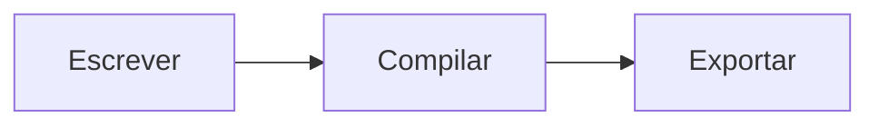

# Projetos, arquivos e Mermaid

Abra uma pasta para usar os controles sobre a árvore de arquivos. Escolha a pasta principal ou uma subpasta ao criar um diretório, criar um documento `.cb` ou copiar um item do computador. O Studio mantém os arquivos com nomes já existentes.

Para importar uma imagem, informe uma URL HTTP ou HTTPS, carregue a prévia e escolha o destino e o nome. O Studio aceita PNG e JPEG de até 12 MiB e usa a extensão do formato recebido. Depois, referencie o arquivo com ``. O caminho é relativo ao documento que contém a figura.

## Mermaid integrado

Insira o bloco abaixo e compile pelo Studio.

````carbon

````

As bibliotecas `.mmd` importadas com `@import` e as chamadas `@mermaid #fig:id` continuam disponíveis. O Studio desenha os diagramas em uma janela isolada do Chromium que já acompanha o Electron. O diagrama é convertido em PNG para inclusão no PDF. O renderizador bloqueia acesso externo e desabilita rótulos HTML na configuração padrão.
